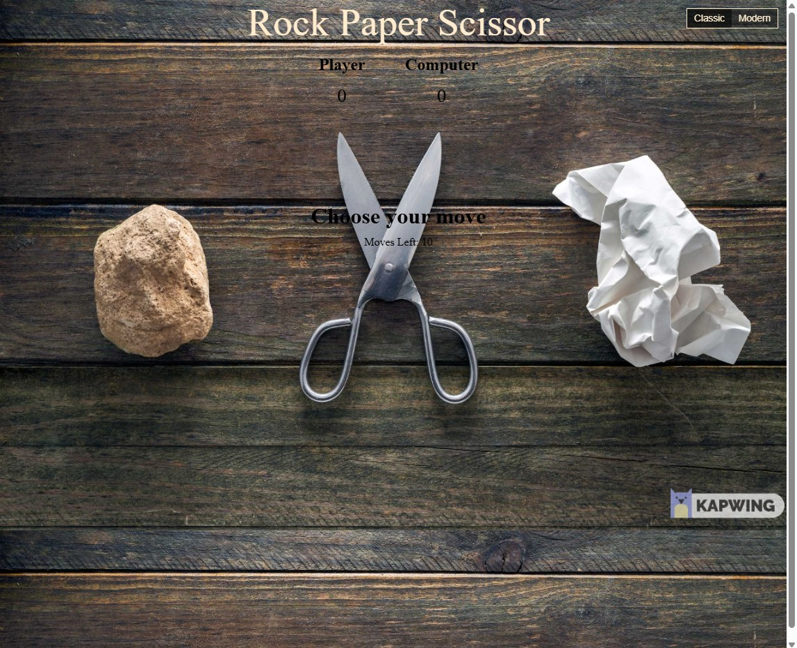

# Rock Paper Scissors

A vanilla HTML, CSS, and JavaScript game. There are two versions of the same project: the original first-website look, and a newer match with custom rounds and object-shaped buttons.

**Demo:** [https://moshahan.github.io/rock-paper-scissors/](https://moshahan.github.io/rock-paper-scissors/)

| Version | Page | Demo |
| --- | --- | --- |
| Modern | `index.html` | [Live](https://moshahan.github.io/rock-paper-scissors/) |
| Classic | `classic.html` | [Live](https://moshahan.github.io/rock-paper-scissors/classic.html) |

Use the **Classic / Modern** control in the top-right to switch.

## Project structure

```text
.
├── index.html          # modern version
├── classic.html        # original version
├── css/
│   ├── modern.css
│   └── classic.css
├── js/
│   ├── dom.js          # shared query and event helpers
│   ├── modern.js
│   └── classic.js
├── assets/             # images, icons, screenshots
└── favicon.ico
```

HTML stays at the repo root so GitHub Pages URLs stay the same. Styles, scripts, and images each have their own folder.

## Screenshots

### Modern

[](https://moshahan.github.io/rock-paper-scissors/)

### Classic

[](https://moshahan.github.io/rock-paper-scissors/classic.html)

## How to play (modern)

1. Pick **Best of 3 / 5 / 7**, **5 rounds**, **10 rounds**, or type a custom match (`best of 9`, `12 rounds`, `first to 4`).
2. Click the **stone**, **paper**, or **scissors**. The clickable area follows the outline of the object, including the holes in the scissor handles.
3. Keyboard: `R`, `P`, `S`.

Best-of matches go to the majority (best of 5 is first to 3). Fixed round matches play every round, ties included, then compare scores.

Classic is the original 10-move game on the wooden table photo.

## Lint

The **Lint** workflow checks HTML, CSS, and JavaScript on every push and pull request. You can run the same checks locally after `npm install --no-save htmlhint stylelint stylelint-config-standard eslint`:

```bash
npx htmlhint "**/*.html"
npx stylelint "**/*.css"
npx eslint "**/*.js"
```
